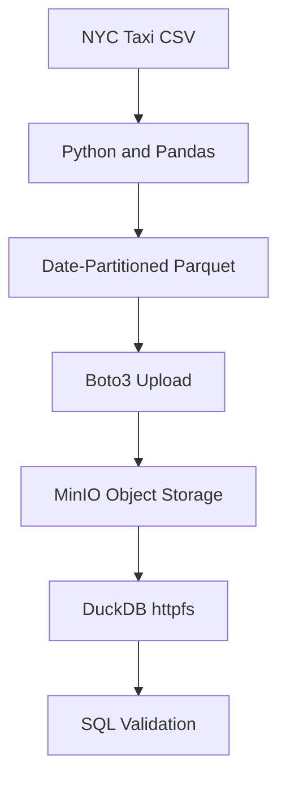

# NYC Taxi — Object Storage Mini-Project

## Objective

Build a local S3-compatible data pipeline using NYC Taxi records,
partitioned Parquet, MinIO, Boto3, and DuckDB.

## Architecture

## Tools

Python, Pandas, PyArrow, Docker, Colima, MinIO, Boto3, DuckDB.

## Implementation

| Step | Script |
|---|---|
| Compare CSV and Parquet | `../src/compare_formats.py` |
| Create Parquet partitions | `../src/partition_taxi_data.py` |
| Read date partitions | `../src/read_partition.py` |
| Compare external and native storage | `../src/external_vs_native.py` |
| Benchmark query performance | `../src/benchmark_storage.py` |
| Upload objects to MinIO | `../src/upload_to_minio.py` |
| Query MinIO through S3 API | `../src/query_minio.py` |
| Inspect query plans | `../src/query_optimization.py` |

## Verified Results

| Metric | Result |
|---|---:|
| Dataset records | 500,000 |
| Date partitions | 8 |
| Parquet objects uploaded | 8 |
| January 1 records | 66,984 |
| January 1 revenue | $1,973,735.87 |
| Storage reduction using Parquet | 81.31% |
| Validation | Passed |

## Security

Credentials are stored locally in `.env.minio`, which is
excluded from Git. MinIO object data is also Git-ignored.

## Limitations

MinIO is a local S3-compatible environment, not AWS S3.

DuckDB's external Parquet view illustrates external
querying but is not a Snowflake external table.

Real cloud warehouse integration remains pending.
