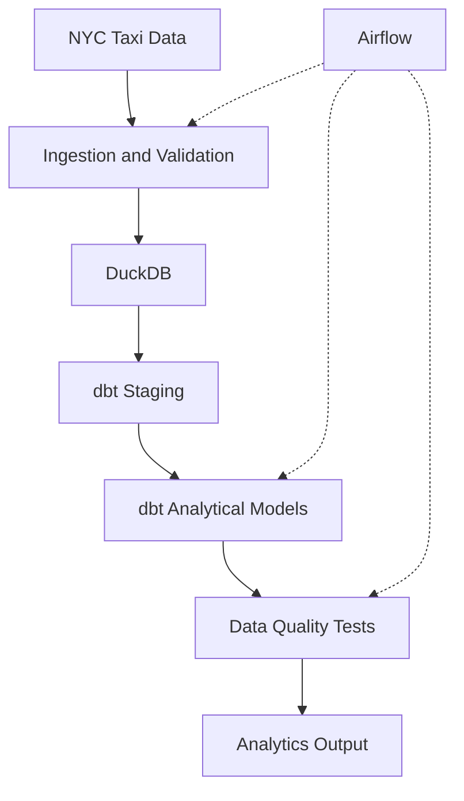

# Month 2 Internship Progress Report

**Data Engineering Internship | Weeks 5–8**

| Field | Details |
|---|---|
| Intern | Simran Thapa |
| Organization | Codavatar |
| Track | Data Engineering |
| Reporting period | Month 2 (Weeks 5–8) |
| Report prepared | 6 November 2026 |
| GitHub | [Sunflowers8/data-engineering](https://github.com/Sunflowers8/data-engineering) |

## 1. Executive Summary

During the second month of my Data Engineering internship, I focused on building more structured, automated and reliable data pipelines.

The learning activities covered analytical storage, Parquet, dbt transformations, Apache Airflow, Docker and CI/CD. I continued working with NYC Taxi data while developing practical experience in orchestration, testing and reproducibility.

The main improvement from Month 1 was moving from individual processing scripts toward connected workflows with clear dependencies and data-quality checks.

## 2. Weekly Progress

| Week | Focus | Work completed |
|---|---|---|
| **5** | Storage and warehousing | Parquet, partitioning, MinIO, DuckDB, cloud storage and warehouse concepts |
| **6** | dbt transformations | Staging and analytical models, incremental materialization, tests and documentation |
| **7** | Airflow orchestration | DAGs, scheduling, dependencies, retries, dbt integration and failure handling |
| **8** | Docker and CI/CD | Dockerfiles, Docker Compose, automated Python tests and GitHub Actions |

### Week 5 — Storage and Warehousing

- Compared CSV and Parquet file formats.
- Practiced working with partitioned datasets using DuckDB.
- Studied how columnar storage improves analytical query efficiency.
- Explored object storage concepts using MinIO.
- Reviewed partition pruning, clustering and cloud warehouse cost considerations.
- Observed approximately 81.31% storage reduction in a Parquet comparison exercise.

**Week 5 artifacts:** [`05-week-cloud-storage/`](../05-week-cloud-storage/)

### Week 6 — dbt and Analytics Engineering

- Configured dbt Core with the DuckDB adapter.
- Created staging and analytical SQL models.
- Used `source()` and `ref()` for model dependencies.
- Practiced view, table and incremental materializations.
- Added schema and data-quality tests.
- Verified three models and 11 passing tests during practice.

**Week 6 artifacts:** [`06-week-dbt/`](../06-week-dbt/)

### Week 7 — Apache Airflow

- Studied DAG structure, scheduling and task dependencies.
- Practiced retries, failure handling and execution monitoring.
- Integrated ingestion, DuckDB and dbt processing steps.
- Used a local Docker-based Airflow environment.
- Verified four successful workflow tasks and 11 passing dbt tests.
- Reviewed the importance of safe reruns and historical backfills.

**Week 7 artifacts:** [`07-week-airflow/`](../07-week-airflow/)

### Week 8 — Docker and CI/CD

- Developed a small Python application for taxi revenue analysis.
- Created a Dockerfile and Docker Compose configuration.
- Practiced building and running containers.
- Added Python unit tests to validate application behavior.
- Configured GitHub Actions for automated testing and builds.
- Verified local execution and reviewed reproducible environment setup.

**Week 8 artifacts:** [`08-week-docker-cicd/`](../08-week-docker-cicd/)

## 3. Major Practical Work — NYC Taxi Data Pipeline

### Dataset and Scope

| Item | Detail |
|---|---|
| Dataset | NYC Yellow Taxi trip data |
| Working sample | Approximately 500,000 trips |
| Data format | Parquet |
| Processing | Python, SQL and DuckDB |
| Transformations | dbt |
| Orchestration | Apache Airflow |
| Reproducibility | Docker and GitHub Actions exercises |

### Workflow

### Data Quality and Reliability

- Validated source data before analytical processing.
- Tested model keys and required fields using dbt.
- Used Airflow dependencies to control execution order.
- Practiced troubleshooting failed tasks through logs.
- Studied incremental processing and rerun safety.
- Reviewed how partitioning affects analytical performance.

## 4. Tools and Technical Skills

| Category | Tools / concepts |
|---|---|
| Programming | Python, SQL |
| Storage | CSV, Parquet, MinIO |
| Databases | DuckDB, PostgreSQL |
| Analytics engineering | dbt Core, Jinja, model materializations |
| Orchestration | Apache Airflow, DAGs, retries |
| Testing | dbt tests, pytest, validation |
| Development | Docker, Docker Compose, Git, GitHub Actions |
| Data processing | Pandas, partitioning, incremental processing |

## 5. Challenges and Resolutions

| Challenge | Action / lesson |
|---|---|
| Choosing storage formats | Compared Parquet and CSV for analytical use cases. |
| Understanding dbt dependencies | Used `source()` and `ref()` to organize transformations. |
| Coordinating pipeline execution | Defined task dependencies and retries in Airflow. |
| Managing local environments | Practiced Docker-based setup and repeatable commands. |
| Ensuring reliable output | Used data-quality tests and reviewed incremental processing risks. |

## 6. Evidence and Deliverables

- **Repository:** [Sunflowers8/data-engineering](https://github.com/Sunflowers8/data-engineering)
- **Week 5:** Storage and Parquet exercises.
- **Week 6:** dbt models and data-quality tests.
- **Week 7:** Airflow DAGs and orchestration exercises.
- **Week 8:** Docker application, tests and CI/CD configuration.

### Additional Work After the Core Modules

Following Weeks 5–8, I continued with PySpark, Kafka and the [ShopFlow practical](../shopflow-practical/).

The ShopFlow exercise combined Python ingestion, DuckDB, SQL, dimensional modeling and dbt. It demonstrated safe batch reruns, with 24 unique orders and nine passing dbt tests.

The practical assessment awarded 76/80 for logical correctness plus 20 grace marks, resulting in 96/100. The feedback identified incremental backfill handling, Airflow portability and reproducible setup as areas for improvement.

## 7. Reflection

The most important lesson from Month 2 was that a reliable pipeline requires more than successful data transformation. It also needs task dependencies, testing, meaningful error handling and a reproducible environment.

I became more comfortable understanding how dbt, Airflow and Docker serve different purposes within a data engineering workflow.

I also learned that technical complexity should be justified by the actual workload rather than added unnecessarily.

## 8. Next Learning Plan

| Priority | Planned focus |
|---|---|
| **1** | Improve incremental loading and historical backfills |
| **2** | Add automated tests for duplicates, errors and late data |
| **3** | Make Airflow workflows portable across environments |
| **4** | Practice cloud warehouse and object storage integration |
| **5** | Build an independently reproducible capstone pipeline |

## 9. Conclusion

Month 2 strengthened my practical understanding of analytical storage, dbt transformations, workflow orchestration and automated development practices.

The next priority is improving reliability and production readiness through stronger tests, safer backfills and clearer documentation.

---

**Prepared by:** Simran Thapa  
**Supervisor review / comments:** __________________________
