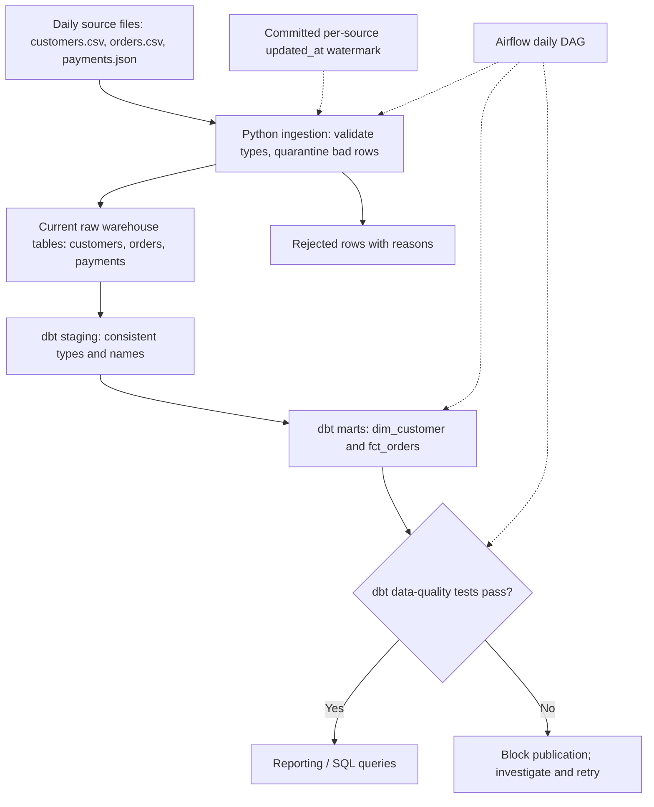

# ShopFlow — Batch Pipeline Design and Assumptions

## Objective
Build a daily batch pipeline that turns imperfect customer, order, and payment files into reliable order-level analytics. It must tolerate bad individual records, process late updates, and be safe to rerun.

## Architecture

## Assumptions and design decisions

1. **Batch rather than streaming:** The business needs a daily report. Daily files already arrive in batches, so streaming would add complexity without a stated benefit.
2. **Source keys:** `customer_id`, `order_id`, and `payment_id` are the business keys. Missing required keys are rejected and logged with reasons rather than silently accepted.
3. **Deterministic current record:** Resolve repeated business keys using the largest `updated_at`; if timestamps tie, select the largest `source_seq`, as specified by the dataset. Use this ordering consistently in ingestion and SQL/dbt.
4. **Fact grain:** One row in `fct_orders` represents one **current business order** (`order_id`), never one payment attempt. `total_amount` is counted as order sales only when the latest order status is `completed`. A separate indicator/measure can represent captured payment, derived after payment attempts are resolved by `payment_id` and summarized to the order level.
5. **No double-counting:** Upsert current records by their business keys and use `order_id` as the unique key in the order fact. Aggregate payment attempts before joining to orders. A failed, initiated, or refunded payment does not count as captured revenue; even two captured attempts must not duplicate order sales.
6. **Incremental watermark:** Maintain a committed high-watermark based on source `updated_at` for each source (customers, orders, payments). Advance it only after a successful, transactional load; a rerun of the same input window should not append duplicate business records. For overlapping timestamps, replay the boundary or use the `(updated_at, source_seq)` ordering and upsert.
7. **Late arrivals and backfill:** A record can arrive today for an earlier `order_ts` day. Filter changed records by `updated_at`, not only by order date. A controlled backfill accepts an explicit batch/date range and reprocesses it through the same idempotent merge logic without incorrectly advancing the regular incremental watermark.
8. **Quality and failure handling:** Validate required columns and types before loading. Quarantine invalid rows. Run key uniqueness, non-null, status validation and fact-to-dimension relationship checks before publishing. Fatal file/database errors stop the run and block downstream steps.

## Verification plan

- Load `raw/2026-10-01/`, then `raw/2026-10-02/`, then rerun `raw/2026-10-02/`.
- Confirm exactly one current row per non-null customer/order/payment business key and that business-key counts and fact sales totals do not change on the rerun.
- Confirm late changes from October 2 can update orders originally placed on October 1.
- Confirm cancelled orders and uncaptured payment attempts do not contribute to the relevant metrics.
