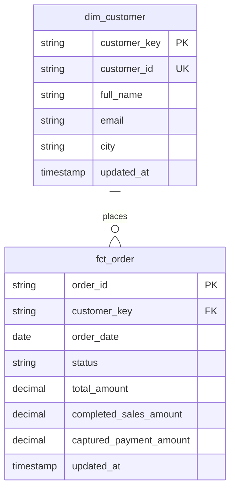

# Question 4 — Dimensional Modeling (14 Marks)

## 1. Customer Dimension — `dim_customer`

**Grain:** One row per current customer.

- **Business Key:** `customer_id`
- **Surrogate Key:** `customer_key`, generated using a stable hash of `customer_id`
- **Attributes:** `full_name`, `email`, `city`, `updated_at`
- **Change Strategy:** Slowly Changing Dimension Type 1 (SCD1)

### Explanation

I chose SCD1 because the current requirement focuses on maintaining the latest customer information. When a customer updates their email or city, the existing record is replaced with the latest information.

If the business needed to track historical changes, I would use SCD2 with effective dates and separate customer versions.

---

## 2. Order Fact Table — `fct_order`

**Grain:** One row per unique business order.

### Keys

- **Business Key:** `order_id`
- **Foreign Key:** `customer_key`, referencing `dim_customer`
- **Degenerate Dimension:** `order_id`

### Attributes

- `order_date`
- `status`
- `updated_at`

### Measures

- `total_amount`
- `completed_sales_amount`
- `captured_payment_amount`

### Additivity

Completed sales amounts are additive across orders and dates because every order appears only once.

Order counts can also be summed across non-overlapping groups.

### Business Logic

- Completed orders contribute to sales.
- Cancelled and pending orders contribute zero completed sales.
- Captured payment amounts are calculated separately from completed-order sales.

---

## 3. Preventing Double-Counting

Duplicate source orders are resolved using `updated_at` and `source_seq`, selecting the latest record for each `order_id`.

Payment records are first deduplicated using `payment_id`.

Only payments with the latest status of `captured` contribute to captured-payment totals.

Payment amounts are aggregated to one row per order before joining with the fact table.

This ensures that multiple payment attempts do not duplicate order records or inflate completed-order sales.

---

## 4. Model Relationships

---
## 5. Payment Reconciliation

The completed-order sales total is 2,590.49 across 18 completed orders.

The captured-payment total is 3,210.49, leaving a difference of 620.00.

The discrepancies are associated with orders O1008, O1014, and O1019.

Orders O1008 and O1019 contain multiple captured payment attempts, while O1014 has a captured payment despite its cancelled order status.

These differences require business reconciliation. The order fact maintains one row per order, preventing payment attempts from multiplying completed-order sales.

Completed sales and captured payments are therefore reported as separate measures.

---

## 6. Design Assumptions

1. Every valid order belongs to one customer.
2. Each `order_id` represents one business order.
3. `updated_at` identifies the latest source version.
4. `source_seq` resolves records with equal timestamps.
5. Customer history is not required for the current reporting model.
6. Failed and refunded payment attempts do not contribute to current captured-payment totals.
7. The model supports safe updates without duplicating business orders.

## Conclusion

This dimensional model separates customer information from order transactions. It supports accurate reporting, protects the order-level grain, and prevents duplicate source records or multiple payment attempts from inflating revenue.
